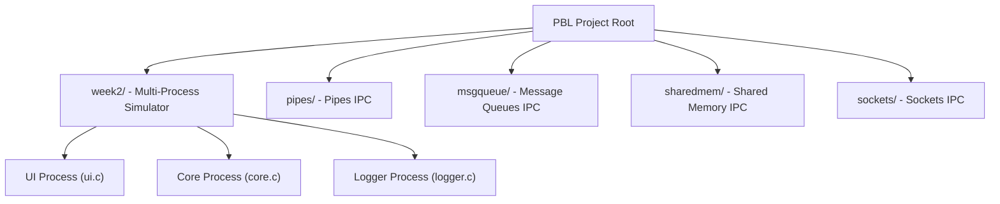

# Inter-Process Communication (IPC) - Project Based Learning (PBL)

## Project Overview

In modern operating systems, processes execute in isolated address spaces protected by hardware memory virtualization. While isolation prevents processes from interfering with each other, complex software systems require separate processes to coordinate, exchange data, and share state. 

This repository documents an academic Project-Based Learning (PBL) initiative exploring **Inter-Process Communication (IPC)** mechanisms under POSIX-compliant operating systems. The project is developed collaboratively with weekly milestones spanning fundamental IPC paradigms, a decoupled multi-process CPU simulator, and process scheduling analytics.

---

## Repository Architecture



---

## Modules and Milestones

### 1. Multi-Process CPU Simulator (`week2/`)

The Week 2 milestone breaks a monolithic CPU simulator into three independent cooperating processes communicating via **POSIX Message Queues** (`<mqueue.h>`):

* **UI Process (`week2/ui.c`):** Provides an interactive CLI for user commands (`LOAD`, `ADD`, `READ`, `WRITE`, `PUSH`, `POP`, `ENQUEUE`, `DEQUEUE`, etc.). Dispatches commands to the Core process over `/pbl_manager_core` and displays responses from `/pbl_core_manager`.
* **Core Process (`week2/core.c`):** Houses the CPU execution engine (registers `R0`-`R7`, ALU arithmetic), virtual memory space (256 addresses), stack (capacity 64), and FIFO queue (capacity 64). Intercepts execution events, logs them to the Logger process, and replies to the UI.
* **Logging Process (`week2/logger.c`):** Serves as an independent daemon capturing all execution events into `cpu_log.txt` and segregating system errors into `error_log.txt`. Confirms message writes back to Core using acknowledgment queues.

For complete compilation instructions, start order guidelines, and command references, see the [Week 2 Documentation](week2/README.md).

### 2. Fundamental IPC Techniques

The repository includes dedicated directories analyzing foundational POSIX IPC mechanisms:

| Mechanism | Description | Directory | Assigned Contributor |
| :--- | :--- | :--- | :--- |
| **Pipes** | Unidirectional FIFO byte stream between related processes | [`pipes/`](pipes/) | Anam (Team Lead) |
| **Message Queues** | Kernel-managed message priority queues with discrete message boundaries | [`msgqueue/`](msgqueue/) | Keith |
| **Shared Memory** | Memory segment mapped directly into multiple virtual address spaces | [`sharedmem/`](sharedmem/) | Brayan |
| **Sockets** | Bidirectional endpoints supporting local (UNIX domain) and network communication | [`sockets/`](sockets/) | Atul |

---

## Team Structure and Responsibilities

| Name | Role | Core Responsibility | Component Area |
| :--- | :--- | :--- | :--- |
| **Anam** | Team Leader | System Integration, Repository Architecture, Benchmarking | Pipes & Architecture |
| **Brayan** | Member | UI / Manager Process Design | Shared Memory & `ui.c` |
| **Keith** | Member | Logging Process Daemon & Reliability | Message Queues & `logger.c` |
| **Atul** | Member | CPU Subsystem & Execution Logic | Sockets & `core.c` |

---

## Prerequisites and Compilation

### Environment Requirements
* **Operating System:** Linux, macOS, or Windows Subsystem for Linux (WSL)
* **Compiler:** `gcc` (with POSIX.1-2008 support)
* **Libraries:** Real-time library (`-lrt`)
* **Build System:** GNU Make

### Quick Start: Building and Running the Simulator

To compile and launch the multi-process simulator:

```bash
# Navigate to the Week 2 simulator directory
cd week2

# Compile all three process binaries
make all

# Launch processes in required startup order (Logger -> Core -> UI)
chmod +x run_simulator.sh
./run_simulator.sh
```

To clean compiled binaries and generated log files:
```bash
make clean
```
