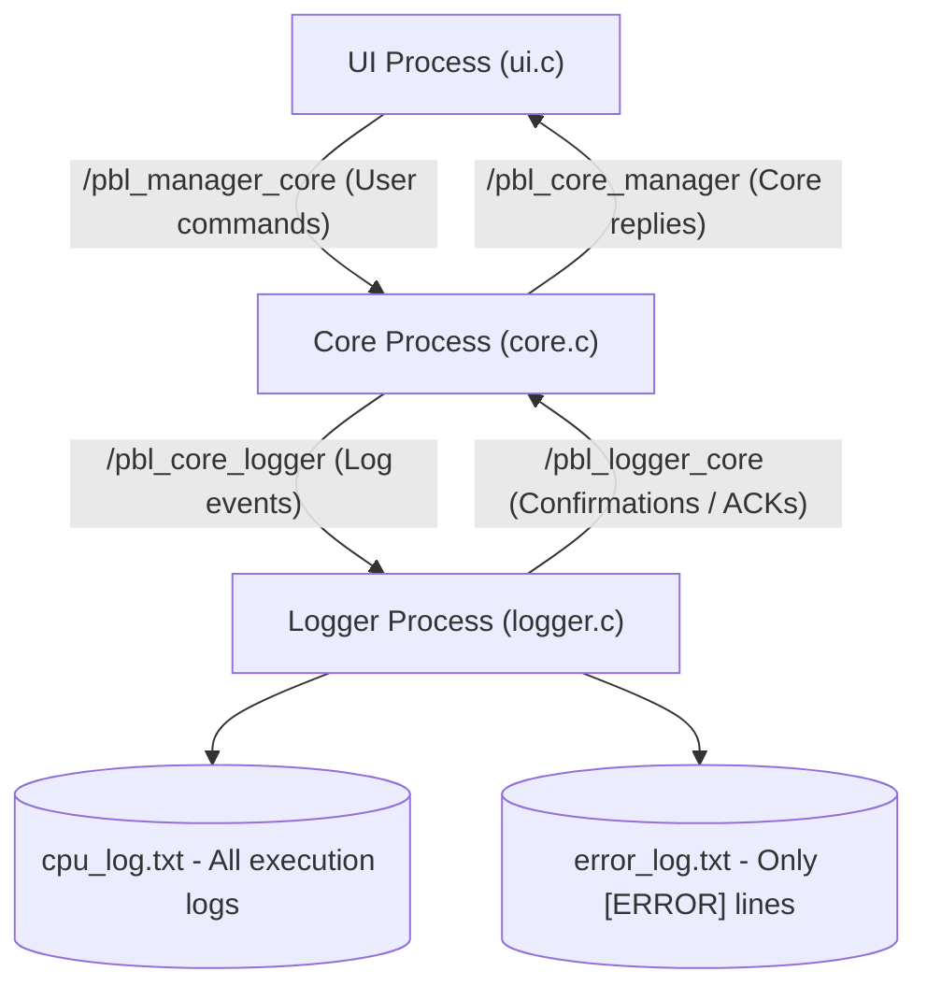
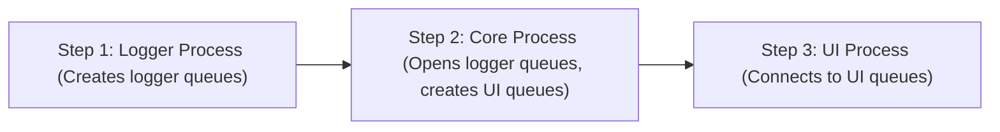

# Week 2 - Multi-Process Simulator & POSIX IPC

## Overview
Week 2 implements the **Multi-Process CPU & Memory Simulator** by decoupling the application into three independent processes communicating over **POSIX Message Queues** (`<mqueue.h>`):

1. **UI Process (`ui.c`):** Interactive user interface CLI prompt, parses user input, sends commands to Core, and prints Core's response.
2. **Core Process (`core.c`):** CPU execution engine (registers `R0`-`R7`, arithmetic), virtual memory space (256 words), stack (64 items), and queue (64 items). Intercepts events, dispatches logs to Logger, waits for ACKs, and replies to UI.
3. **Logging Process (`logger.c`):** Central logging service that appends timestamped entries to `cpu_log.txt`, filters errors to `error_log.txt`, and issues ACKs back to Core.

---

## Architecture and Communication Flow



---

## Startup Order Requirement

Due to queue creation ownership, processes **must** be launched in the following order:



* **Logger creates:** `/pbl_core_logger` and `/pbl_logger_core`.
* **Core connects to:** Logger queues, and **creates:** `/pbl_manager_core` and `/pbl_core_manager`.
* **UI connects to:** UI queues and initiates the interactive session.

---

## Compilation

Build all three binaries using the included `Makefile`:

```bash
cd week2
make all
```

Or compile each individually using `gcc`:
```bash
gcc -Wall -Wextra -O2 -o logger logger.c -lrt
gcc -Wall -Wextra -O2 -o core core.c -lrt
gcc -Wall -Wextra -O2 -o ui ui.c -lrt
```

To clean up binaries and generated log files:
```bash
make clean
```

---

## Execution

### Option A: Automated Script (Recommended)
Run all 3 processes with proper startup sequencing and cleanup traps:
```bash
chmod +x run_simulator.sh
./run_simulator.sh
```

### Option B: Manual Execution (Separate Terminals)
Open 3 terminal windows and run:

**Terminal 1 (Logger first):**
```bash
./logger
```

**Terminal 2 (Core second):**
```bash
./core
```

**Terminal 3 (UI third):**
```bash
./ui
```

---

## Supported Commands

| Category | Command | Description | Example |
| :--- | :--- | :--- | :--- |
| **CPU / Reg** | `LOAD <Rx> <val>` | Load immediate integer into register (`R0`-`R7`) | `LOAD R1 10` |
| **Arithmetic**| `ADD <Rx> <Ry>` | `Rx = Rx + Ry` | `ADD R1 R2` |
| | `SUB <Rx> <Ry>` | `Rx = Rx - Ry` | `SUB R1 R2` |
| | `MUL <Rx> <Ry>` | `Rx = Rx * Ry` | `MUL R1 R2` |
| | `DIV <Rx> <Ry>` | `Rx = Rx / Ry` (division by zero checked) | `DIV R1 R2` |
| | `REGISTERS` | Display current values of `R0` through `R7` | `REGISTERS` |
| **Memory** | `WRITE <addr> <val>` | Write integer into memory address (`0-255`) | `WRITE 10 50` |
| | `READ <addr>` | Read value stored at memory address | `READ 10` |
| | `STORE <Rx> <addr>` | Store value in register `Rx` into memory `addr` | `STORE R1 10` |
| **Stack** | `PUSH <val>` | Push value onto stack (capacity: 64) | `PUSH 10` |
| | `POP` | Pop top value from stack | `POP` |
| | `PEEK` | View top value on stack without removing | `PEEK` |
| | `DISPLAY_STACK` | View full stack from Top to Bottom | `DISPLAY_STACK` |
| **Queue** | `ENQUEUE <val>` | Add integer to FIFO queue (capacity: 64) | `ENQUEUE 10` |
| | `DEQUEUE` | Remove and return front value from queue | `DEQUEUE` |
| | `DISPLAY_QUEUE` | View full queue from Front to Rear | `DISPLAY_QUEUE` |
| **System** | `HELP` | Display available commands | `HELP` |
| | `EXIT` | Coordinates shutdown: notifies Core and Logger, then exits | `EXIT` |

---

## Log Verification

Upon executing commands, verify that log files are created and populated:
* `cpu_log.txt`: Contains every execution event with a timestamp:
  ```text
  [2026-10-15 14:30:00] [INFO] Core process started and ready.
  [2026-10-15 14:30:05] [EXEC] LOAD R1 = 10
  [2026-10-15 14:30:08] [EXEC] PUSH 10 -> Stack Size: 1
  ```
* `error_log.txt`: Contains only intercepted errors (e.g. division by zero, stack underflow, invalid memory address):
  ```text
  [2026-10-15 14:30:15] [ERROR] Division by zero attempted: DIV R1 R2
  ```
