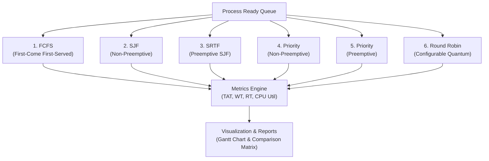

# Week 3 - CPU Process Scheduling Simulator

## Overview

The Week 3 milestone implements an interactive **CPU Process Scheduling Simulator** in C designed to simulate core operating system scheduling policies, compute standard performance metrics, and render execution timelines via ASCII Gantt charts.

The simulator supports both non-preemptive and preemptive algorithms, evaluates trade-offs between turnaround time, waiting time, and response time, and provides side-by-side performance comparisons across identical process workloads.

---

## Supported Scheduling Algorithms



1. **First-Come-First-Served (FCFS):**
   * Non-preemptive.
   * CPU is allocated strictly in order of process arrival time.
   * Susceptible to the *Convoy Effect* where short jobs are blocked behind long CPU-bound tasks.
2. **Shortest Job First (SJF) - Non-Preemptive:**
   * Selects the process with the shortest CPU burst time from all arrived, pending jobs.
   * Minimizes average waiting time among non-preemptive algorithms.
3. **Shortest Remaining Time First (SRTF) - Preemptive SJF:**
   * Evaluates the ready queue at each discrete time unit.
   * If an arriving process has a burst time shorter than the remaining burst of the currently executing job, the running job is preempted.
4. **Priority Scheduling - Non-Preemptive:**
   * Allocates the CPU to the arrived process with the highest priority (lower integer = higher priority).
   * Executes to completion once scheduled.
5. **Priority Scheduling - Preemptive:**
   * Preempts the active process if a newly arrived process possesses a strictly higher priority.
6. **Round Robin (RR):**
   * Preemptive scheduling utilizing a circular FIFO ready queue and a user-configurable Time Quantum ($TQ$).
   * Each process executes for up to $TQ$ units before being preempted and re-enqueued.

---

## Performance Metrics and Formulas

The simulator tracks and calculates the following metrics for each process $i$:

* **Completion Time ($CT$):** Timestamp at which the process finishes execution.
* **Turnaround Time ($TAT$):** Total elapsed time from arrival to completion:
  $$TAT_i = CT_i - AT_i$$
* **Waiting Time ($WT$):** Total time spent waiting in the ready queue:
  $$WT_i = TAT_i - BT_i$$
* **Response Time ($RT$):** Time elapsed between process arrival and first CPU allocation:
  $$RT_i = \text{Start Time}_i - AT_i$$
* **System Aggregate Metrics:**
  * Average Waiting Time: $\text{Avg } WT = \frac{1}{n} \sum WT_i$
  * Average Turnaround Time: $\text{Avg } TAT = \frac{1}{n} \sum TAT_i$
  * Average Response Time: $\text{Avg } RT = \frac{1}{n} \sum RT_i$
  * CPU Utilization:
    $$\text{CPU Utilization} = \left(\frac{\sum BT_i}{\max(CT_i) - \min(AT_i)}\right) \times 100\%$$
  * Total Idle Time: $\text{Total Simulation Time} - \sum BT_i$

---

## File Structure

```
week3/
|-- Makefile        # Build recipes for compilation and benchmark execution
|-- README.md       # Technical specification and user documentation
|-- report.md       # Comparative analysis and benchmark findings
|-- scheduler.h     # Shared types (Process, GanttSegment, ScheduleResult)
|-- scheduler.c     # Interactive CLI menu, input parser, benchmark harness
|-- algorithms.c    # Algorithm logic for all 6 scheduling strategies
`-- gantt.c         # ASCII Gantt chart renderer and comparison matrix generator
```

---

## Compilation

Build the simulator executable using the included Makefile:

```bash
cd week3
make all
```

Or compile manually with GCC:
```bash
gcc -Wall -Wextra -O2 -std=c99 -o scheduler scheduler.c algorithms.c gantt.c
```

To clean compiled binaries and object files:
```bash
make clean
```

---

## Execution Modes

### 1. Interactive Menu
Run the simulator without flags to enter the interactive shell:
```bash
./scheduler
```

From the interactive menu, users can:
* Inspect current dataset
* Manually enter custom process attributes
* Load pre-configured benchmark scenarios
* Generate randomized process workloads
* Simulate individual algorithms with Gantt chart generation
* Run all 6 algorithms concurrently for comparative evaluation
* Adjust Round Robin Time Quantum ($TQ$)

### 2. Automated Benchmark Shortcuts
Run built-in benchmark scenarios directly from the command line:

```bash
# Run Benchmark 1 (Convoy Effect Demonstration)
./scheduler --benchmark 1

# Run Benchmark 2 (Staggered Arrivals and Preemption)
./scheduler --benchmark 2

# Run Benchmark 3 (Round Robin Quantum Sensitivity)
./scheduler --benchmark 3

# Run all algorithms against default workload
./scheduler --compare
```

---

## Sample Outputs

### Process Summary Table & ASCII Gantt Chart
```text
========================================================================================
 Algorithm: SRTF (Shortest Remaining Time First - Preemptive SJF)
========================================================================================
 PID   Arrival   Burst   Priority   Start   Completion   Turnaround   Waiting   Response
----------------------------------------------------------------------------------------
 P1    0         8       3          0       17           17           9         0
 P2    1         4       1          1       5            4            0         0
 P3    2         9       4          17      26           24           15        15
 P4    3         5       2          5       10           7            2         2
----------------------------------------------------------------------------------------
 Average Waiting Time    : 6.50 ms
 Average Turnaround Time : 13.00 ms
 Average Response Time   : 4.25 ms
 Total Simulation Time   : 26 ms
 CPU Busy Time           : 26 ms
 CPU Idle Time           : 0 ms
 CPU Utilization         : 100.00 %
========================================================================================

--- Gantt Chart ---
+-------+-------+-------+-------+
|  P1   |  P2   |  P4   |  P1   |
+-------+-------+-------+-------+
0       1       5       10      17

+-------+
|  P3   |
+-------+
17      26
```

### Comparative Evaluation Matrix
```text
=============================================================================================
                        MULTI-ALGORITHM COMPARATIVE EVALUATION
=============================================================================================
 Algorithm                    | Avg WT(ms) | Avg TAT(ms) | Avg RT(ms) | CPU Util %  | Idle Time
---------------------------------------------------------------------------------------------
 FCFS                         |       6.75 |       13.25 |       6.75 |    100.00%  |       0 ms
 SJF (Non-preemptive)         |       4.75 |       11.25 |       4.75 |    100.00%  |       0 ms
 SRTF (Preemptive SJF)        |       4.25 |       10.75 |       2.25 |    100.00%  |       0 ms
 Priority (Non-preemptive)    |       6.00 |       12.50 |       6.00 |    100.00%  |       0 ms
 Priority (Preemptive)        |       5.25 |       11.75 |       3.50 |    100.00%  |       0 ms
 Round Robin (TQ=2)           |       6.25 |       12.75 |       1.75 |    100.00%  |       0 ms
=============================================================================================
```
