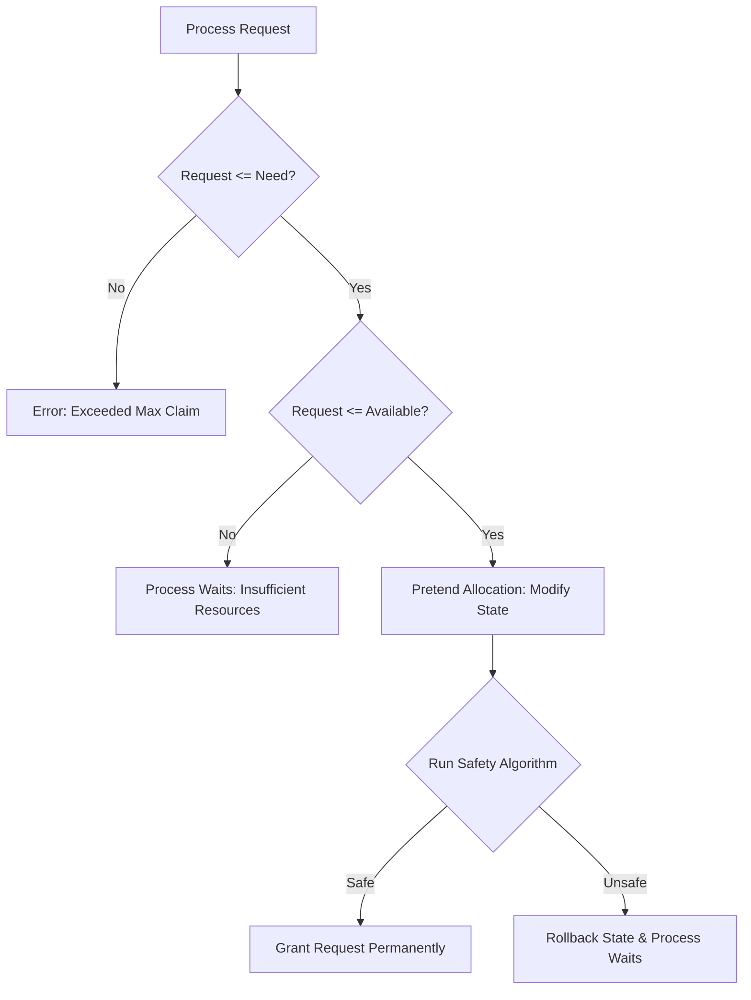
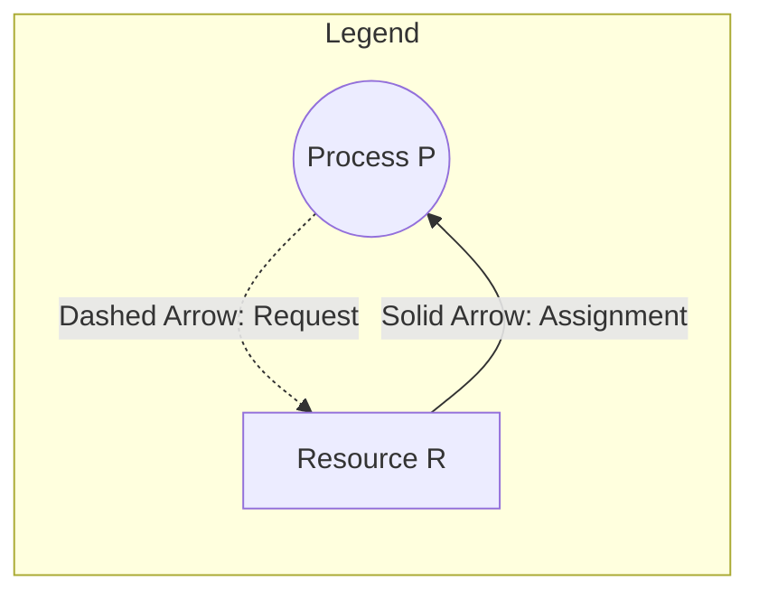

# Week 4: Deadlock Simulation & Avoidance System (OS PBL)

A modern, interactive, web-based Operating Systems Project-Based Learning (PBL) simulation system demonstrating **Deadlock Modeling, Avoidance (Banker's Algorithm), Detection, Recovery, and Resource Allocation Graph (RAG) Visualization**.

---

## 👥 Project Information
- **Course**: Operating Systems (OS) Project-Based Learning (PBL)
- **Week**: 4 — Deadlocks: Avoidance, Detection & Recovery
- **Assigned Team Member**: `TBD`
- **Application Type**: Single-file Interactive Web GUI (`index.html`)

---

## 📑 Table of Contents
1. [Overview](#-overview)
2. [What is a Deadlock?](#-what-is-a-deadlock)
   - [The 4 Coffman Conditions](#the-4-coffman-conditions)
3. [Banker's Algorithm (Deadlock Avoidance)](#-bankers-algorithm-deadlock-avoidance)
   - [Core Data Structures](#core-data-structures)
   - [Safety Algorithm](#1-safety-algorithm)
   - [Resource-Request Algorithm](#2-resource-request-algorithm)
4. [Deadlock Detection Algorithm](#-deadlock-detection-algorithm)
5. [Resource Allocation Graph (RAG)](#-resource-allocation-graph-rag)
   - [Graph Components](#graph-components)
   - [Cycle vs. Deadlock Relationship](#cycle-vs-deadlock-relationship)
6. [Deadlock Recovery Strategies](#-deadlock-recovery-strategies)
7. [System Features & Architecture](#-system-features--architecture)
8. [How to Run](#-how-to-run)
9. [User Guide & Feature Walkthrough](#-user-guide--feature-walkthrough)
10. [Example Walkthroughs](#-example-walkthroughs)
    - [Preset 1: Banker's Algorithm Safe State](#preset-1-bankers-algorithm-safe-state-4-processes-3-resources)
    - [Preset 2: Circular Wait Deadlock State](#preset-2-circular-wait-deadlock-state-3-processes-2-resources)
11. [Troubleshooting & Verification](#-troubleshooting--verification)

---

## 🌟 Overview

Deadlock is one of the most critical concurrency hazards in modern multitasking operating systems. When multiple concurrent processes compete for a finite set of non-shareable resources, processes may enter a permanent wait state if circular resource dependencies arise.

This simulation platform offers a full graphical laboratory to:
- Dynamically manipulate resource claims, allocations, and system availability.
- Trace Dijkstra's **Banker's Algorithm** with step-by-step vector progression.
- Run multi-resource **Deadlock Detection** via graph reduction.
- Visualize states in real time on an interactive **Resource Allocation Graph (RAG)** HTML5 canvas with cycle detection.
- Simulate **Resource Requests** with hypothetical safety admission checks.
- Test **Recovery from Deadlock** via selective process termination and resource reclamation.



---

## 🔒 What is a Deadlock?

A **deadlock** occurs in an operating system when a set of concurrent processes are blocked because each process holds resources and waits for resources held by other processes in the same set. None of the processes can run, release resources, or terminate.

### The 4 Coffman Conditions
For a deadlock to occur, all four of the following conditions must hold simultaneously:

| Condition | Description | Real-World OS Analogy |
| :--- | :--- | :--- |
| **1. Mutual Exclusion** | At least one resource must be non-shareable; only one process can hold it at any time. | A printer or exclusive write lock on a disk sector. |
| **2. Hold and Wait** | A process must be currently holding at least one resource while waiting to acquire additional resources held by others. | Process holding file handle $F_1$ and requesting file handle $F_2$. |
| **3. No Preemption** | Resources cannot be forcibly seized from a process; they can only be released voluntarily upon task completion. | A process writing to a tape drive cannot have the drive yanked away mid-write. |
| **4. Circular Wait** | A closed chain of processes $\{P_0, P_1, \dots, P_n\}$ exists where $P_0$ waits for a resource held by $P_1$, $P_1$ waits for $P_2$, $\dots$, and $P_n$ waits for $P_0$. | A classic traffic gridlock intersection. |

> [!NOTE]
> Eliminating any single one of these four conditions is the foundational basis of **Deadlock Prevention**.

---

## 🏦 Banker's Algorithm (Deadlock Avoidance)

Formulated by **Edsger Dijkstra**, the Banker's Algorithm is a resource allocation and deadlock avoidance algorithm. It gets its name from banking operations where cash credit is granted only if the bank maintains enough cash reserves to satisfy the maximum borrowing demand of at least one client.

### Core Data Structures
Let:
- $n =$ Number of active processes ($P_0, P_1, \dots, P_{n-1}$)
- $m =$ Number of distinct resource types ($R_0, R_1, \dots, R_{m-1}$)

1. **Available Vector** of length $m$:
   - $\text{Available}[j] = k$ means $k$ instances of resource type $R_j$ are currently unassigned and ready for allocation.
2. **Maximum Matrix** of size $n \times m$:
   - $\text{Maximum}[i][j] = k$ defines the maximum demand of process $P_i$ for resource type $R_j$.
3. **Allocation Matrix** of size $n \times m$:
   - $\text{Allocation}[i][j] = k$ denotes that process $P_i$ currently holds $k$ instances of resource type $R_j$.
4. **Need Matrix** of size $n \times m$:
   - $\text{Need}[i][j] = \text{Maximum}[i][j] - \text{Allocation}[i][j]$.
   - Represents the remaining resources process $P_i$ may request before terminating.

---

### 1. Safety Algorithm
Used to test whether the system is in a **Safe State** (i.e., whether an execution sequence $\langle P_0, P_1, \dots, P_{n-1} \rangle$ exists such that each process can satisfy its remaining claim and terminate without triggering deadlock).

```
Step 1: Let Work = Available (vector of length m)
        Let Finish = [false, false, ..., false] (boolean vector of length n)

Step 2: Find an index i such that:
        a) Finish[i] == false
        b) Need[i] <= Work (Need[i][j] <= Work[j] for all j = 0, ..., m-1)
        If no such i exists, proceed to Step 4.

Step 3: Work = Work + Allocation[i]
        Finish[i] = true
        Append P_i to SafeSequence
        Go back to Step 2.

Step 4: If Finish[i] == true for all i = 0, ..., n-1:
        The system is in a SAFE STATE with safe sequence: SafeSequence.
        Else:
        The system is in an UNSAFE STATE.
```

---

### 2. Resource-Request Algorithm
When a process $P_i$ makes an explicit resource request vector $\text{Request}_i$:

```
Step 1: If Request_i[j] <= Need[i][j] for all j:
        Proceed to Step 2.
        Else:
        Error: Process P_i exceeded its declared maximum claim! Reject request.

Step 2: If Request_i[j] <= Available[j] for all j:
        Proceed to Step 3.
        Else:
        Wait: Resources not available. Process P_i must wait until resources are freed.

Step 3: Pretend allocation (Hypothetical State):
        Available'  = Available - Request_i
        Allocation' = Allocation + Request_i
        Need'       = Need - Request_i

Step 4: Run the Safety Algorithm on the hypothetical state (Available', Allocation', Need').
        If SAFE:
            Commit the allocation permanently!
        Else:
            Roll back hypothetical state. Process P_i must wait; request denied.
```

---

## 🔍 Deadlock Detection Algorithm

While avoidance algorithms (like Banker's) check safety before granting requests, **Deadlock Detection** is invoked periodically or on demand to determine whether active processes have already become deadlocked.

For systems with multiple instances of each resource type:
1. **Work Vector**: Initialized to $\text{Available}$.
2. **Finish Vector**: Initialized based on current allocations:
   $$\text{Finish}[i] = \begin{cases} \text{true} & \text{if } \text{Allocation}[i][j] = 0 \text{ for all } j \\ \text{false} & \text{otherwise} \end{cases}$$
   *(Processes that currently hold no resources cannot be part of a deadlock cycle).*
3. **Reduction Loop**:
   - Find an index $i$ where $\text{Finish}[i] = \text{false}$ and $\text{Need}[i] \le \text{Work}$.
   - If found:
     $$\text{Work} = \text{Work} + \text{Allocation}[i]$$
     $$\text{Finish}[i] = \text{true}$$
   - Repeat until no further process can be satisfied.
4. **Conclusion**:
   - If $\text{Finish}[i] == \text{false}$ for any process $P_i$, then **$P_i$ is deadlocked**.
   - If all $\text{Finish}[i] == \text{true}$, **no deadlock exists**.

---

## 🕸️ Resource Allocation Graph (RAG)

The **Resource Allocation Graph (RAG)** is a directed bipartite graph $G = (V, E)$ used to visually model resource dependencies:
- **Vertices ($V$)**: Partitioned into two sets:
  - **Process Nodes ($P$)**: Drawn as circles labeled $P_0, P_1, \dots$
  - **Resource Nodes ($R$)**: Drawn as rounded rectangles labeled $R_0, R_1, \dots$, containing dots representing individual resource instances.
- **Edges ($E$)**:
  - **Assignment Edge ($R_j \to P_i$)**: Directed solid arrow from resource $R_j$ to process $P_i$. Indicates an instance of $R_j$ is allocated to $P_i$.
  - **Request Edge ($P_i \to R_j$)**: Directed dashed arrow from process $P_i$ to resource $R_j$. Indicates process $P_i$ is waiting for an instance of $R_j$.



### Cycle vs. Deadlock Relationship

| Resource Type | Condition for Deadlock |
| :--- | :--- |
| **Single-Unit Resources** (1 instance per type) | A directed cycle in the RAG is **necessary and sufficient** for deadlock. (Cycle $\iff$ Deadlock). |
| **Multi-Unit Resources** (Multiple instances per type) | A directed cycle in the RAG is **necessary but not sufficient**. (Cycle $\impliedby$ Deadlock). |

> [!IMPORTANT]
> In our simulation, the RAG canvas automatically highlights circular wait cycles in pulsating **crimson red (`#ef4444`)**, making cyclic wait paths instantly visible.

---

## 🛠️ Deadlock Recovery Strategies

Once deadlock is identified by the detection algorithm, the system must recover by breaking the circular wait. The simulation provides an interactive recovery suite:

1. **Process Termination**:
   - **Abort all deadlocked processes**: Drastic and expensive (cancels partial work).
   - **Abort one process at a time**: Terminate a deadlocked process, release all its held resources back to the $\text{Available}$ vector, and re-run detection until the deadlock cycle is broken.
2. **Victim Selection**:
   - The simulation's **Auto-Terminate Optimal Process** feature selects the victim process that holds the largest quantity of contested resources, minimizing the number of terminations required.

---

## 💻 System Features & Architecture

```
week4/
├── index.html       # Self-contained dark-mode dashboard (HTML5 + CSS3 + Vanilla ES6)
└── README.md        # Comprehensive technical documentation & walkthrough
```

### Design Highlights:
- **Aesthetic**: Deep dark canvas (`#090b14`), electric blue (`#4f8ef7`) safe accents, amber (`#f59e0b`) warning states, and glowing crimson (`#ef4444`) deadlock alerts.
- **Glassmorphism**: Translucent card panels with backdrop blur and responsive flex/grid layouts.
- **Zero External Dependencies**: Pure client-side JavaScript and HTML5 Canvas (Google Fonts imported via CDN).
- **Interactive Canvas Engine**:
  - Drag-and-drop nodes to custom arrange the graph.
  - One-click auto layouts: **Bipartite Layout** (Processes on left, Resources on right) and **Circular Layout**.
  - Dynamic curve routing: Bidirectional edges between $P_i$ and $R_j$ curve smoothly in opposite directions with arrowheads so they never collide.
  - Instance dot rendering inside resource boxes (filled blue = allocated, green = available).
- **Live Reactive Synchronization**: Any edit to the Available, Allocation, or Maximum inputs immediately recomputes the Need matrix and re-renders the RAG.

---

## 🚀 How to Run

No installations, build steps, or server setups are required:

1. Navigate to:
   ```
   C:\Users\LENOVO\OneDrive\Desktop\PBL\PBL\week4\
   ```
2. Double-click **`index.html`** or right-click $\to$ **Open with** $\to$ **Google Chrome / Microsoft Edge / Firefox**.
3. The application will immediately launch in full interactive mode!

---

## 📖 User Guide & Feature Walkthrough

### 1. Preset Buttons
- **`Preset: Banker's Safe (4P, 3R)`**: Pre-fills the classic Dijkstra 4-process, 3-resource safe state.
- **`Preset: Deadlock State (3P, 2R)`**: Pre-fills a classic 3-process, 2-resource deadlock state where $P_0$ and $P_1$ are locked in circular wait.
- **`Reset`**: Blanks all matrices to default zeros.

### 2. System Configuration & Matrix Editor
- Set the number of processes $P$ ($1 \le P \le 8$) and resource types $R$ ($1 \le R \le 6$) and click **Initialize Grids**.
- Edit values in:
  - **Available Vector**: Free units per resource.
  - **Allocation Matrix**: Units currently assigned to each process.
  - **Maximum Matrix**: Peak demand declared by each process.
- **Need Matrix**: Automatically calculated ($Need = Max - Alloc$). If $Alloc > Max$, the cell is highlighted red as an invalid constraint.

### 3. Simulation Actions
- **Run Banker's Algorithm**: Evaluates whether the system is in a safe state, extracts the safe sequence, and prints a step-by-step trace of the `Work` vector.
- **Detect Deadlock**: Runs graph reduction and highlights any deadlocked process set.
- **Request Resources**: Opens a simulation dialog to specify a process $P_i$ and a request vector $[r_0, r_1, \dots]$. Tests $Req \le Need$ and $Req \le Avail$, simulates the allocation, runs safety verification, and allows one-click permanent commit.
- **Recover Deadlock**: Opens the recovery assistant. Lists deadlocked processes, displays their held allocations, and enables manual or automated process termination to reclaim resources.

---

## 📊 Example Walkthroughs

### Preset 1: Banker's Algorithm Safe State (4 Processes, 3 Resources)

#### Initial Parameters:
- **Available**: `[3, 3, 2]`
- **Allocation Matrix**:
  $$P_0: [0, 1, 0]$$
  $$P_1: [2, 0, 0]$$
  $$P_2: [3, 0, 2]$$
  $$P_3: [2, 1, 1]$$
- **Maximum Matrix**:
  $$P_0: [7, 5, 3]$$
  $$P_1: [3, 2, 2]$$
  $$P_2: [9, 0, 2]$$
  $$P_3: [2, 2, 2]$$
- **Calculated Need Matrix**:
  $$P_0: [7, 4, 3]$$
  $$P_1: [1, 2, 2]$$
  $$P_2: [6, 0, 0]$$
  $$P_3: [0, 1, 1]$$

#### Step-by-Step Execution:
1. **Initialize**: $\text{Work} = [3, 3, 2]$, $\text{Finish} = [F, F, F, F]$.
2. **Check $P_0$**: $\text{Need}_0 = [7, 4, 3] \nle [3, 3, 2]$. (Cannot execute).
3. **Check $P_1$**: $\text{Need}_1 = [1, 2, 2] \le [3, 3, 2]$!
   - $P_1$ finishes. Releases $[2, 0, 0]$.
   - $\text{Work} = [3, 3, 2] + [2, 0, 0] = [5, 3, 2]$.
   - $\text{Finish}[1] = T$.
4. **Check $P_3$**: $\text{Need}_3 = [0, 1, 1] \le [5, 3, 2]$!
   - $P_3$ finishes. Releases $[2, 1, 1]$.
   - $\text{Work} = [5, 3, 2] + [2, 1, 1] = [7, 4, 3]$.
   - $\text{Finish}[3] = T$.
5. **Check $P_0$**: $\text{Need}_0 = [7, 4, 3] \le [7, 4, 3]$!
   - $P_0$ finishes. Releases $[0, 1, 0]$.
   - $\text{Work} = [7, 4, 3] + [0, 1, 0] = [7, 5, 3]$.
   - $\text{Finish}[0] = T$.
6. **Check $P_2$**: $\text{Need}_2 = [6, 0, 0] \le [7, 5, 3]$!
   - $P_2$ finishes. Releases $[3, 0, 2]$.
   - $\text{Work} = [7, 5, 3] + [3, 0, 2] = [10, 5, 5]$.
   - $\text{Finish}[2] = T$.

**Result**: ✅ **SAFE STATE** with verified sequence:
$$\mathbf{P_1 \longrightarrow P_3 \longrightarrow P_0 \longrightarrow P_2}$$

---

### Preset 2: Circular Wait Deadlock State (3 Processes, 2 Resources)

#### Initial Parameters:
- **Available**: `[0, 0]`
- **Allocation Matrix**:
  $$P_0: [1, 0]$$
  $$P_1: [0, 1]$$
  $$P_2: [0, 0]$$
- **Maximum Matrix**:
  $$P_0: [1, 1]$$
  $$P_1: [1, 1]$$
  $$P_2: [1, 1]$$
- **Calculated Need Matrix**:
  $$P_0: [0, 1]$$
  $$P_1: [1, 0]$$
  $$P_2: [1, 1]$$

#### Detection Analysis:
1. $\text{Work} = [0, 0]$.
2. $P_2$ has $\text{Allocation} = [0, 0]$, so $\text{Finish}[2] = T$ immediately.
3. $P_0$ holds $R_0$ (1 unit) and needs $R_1$ (1 unit). But $\text{Available}[R_1] = 0$. $P_0$ is blocked waiting for $R_1$.
4. $P_1$ holds $R_1$ (1 unit) and needs $R_0$ (1 unit). But $\text{Available}[R_0] = 0$. $P_1$ is blocked waiting for $R_0$.
5. In the Resource Allocation Graph:
   $$R_0 \xrightarrow{\text{alloc}} P_0 \xrightarrow{\text{req}} R_1 \xrightarrow{\text{alloc}} P_1 \xrightarrow{\text{req}} R_0$$
   A closed directed cycle exists!
6. **Detection Result**: 🚨 **DEADLOCK DETECTED! Deadlocked processes: $\{P_0, P_1\}$.**

#### Recovery Demonstration:
1. Click **Recover Deadlock** $\to$ **Auto-Terminate Optimal Process**.
2. Process $P_0$ is terminated, releasing its held $[1, 0]$ of $R_0$ back to $\text{Available}$.
3. $\text{Available}$ becomes $[1, 0]$.
4. Now $P_1$ can acquire $R_0$ because its need is $[1, 0] \le [1, 0]$!
5. The circular dependency is broken, and the system transitions back to **SAFE / DEADLOCK-FREE**.

---

## 🔧 Troubleshooting & Verification

- **Matrix Input Validation**: If you input a value into the Allocation matrix that is larger than the Maximum matrix, the input cell turns red. The system clamps Need to $\ge 0$.
- **Graph Node Overlap**: You can click and drag any node on the canvas to un-clutter dense connections, or click **Bipartite** / **Circle** / **Center** to reset layout.
- **Browser Compatibility**: Fully supported in Google Chrome, Microsoft Edge, Mozilla Firefox, Opera, and Safari (desktop & mobile).

---

## 📜 Academic Reference & Attribution
- Silberschatz, A., Galvin, P. B., & Gagne, G. *Operating System Concepts* (10th ed.), Chapter 8: Deadlocks.
- Dijkstra, E. W. (1965). *Cooperating Sequential Processes*, Technological University Eindhoven.
